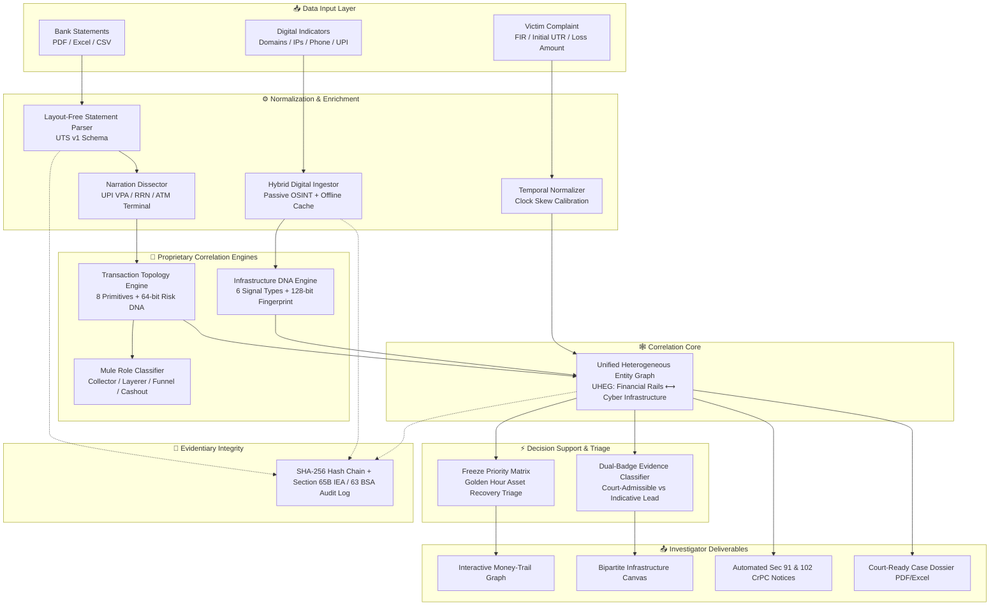
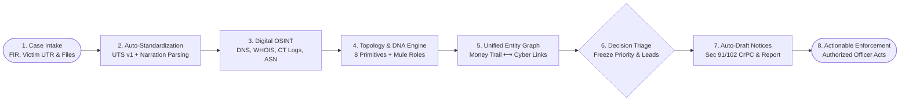

# 🧭 NAUTILUS

**N**etwork **A**nalysis for **U**nified **T**racing of **I**llicit **L**edgers & **U**nderlying **S**ystems

> *Just like the submarine Nautilus explored the hidden depths of the ocean, NAUTILUS dives beneath the surface of a fraud case to reveal the hidden network connecting money and digital infrastructure.*

[](https://github.com)
[](https://github.com)
[](https://github.com)
[](https://github.com)
[](https://python.org)

**Problem Statement:** PS05 — Financial Crime Analytics & Digital Infrastructure Intelligence  
**Hackathon:** Rajasthan Police Cyber Security Hackathon 2026  

---

## 📖 Overview

Online financial fraud rarely stops at one transfer — money hops across multiple accounts in minutes, while scammers rely on disposable domains, IP addresses, phone numbers, and UPI handles to run and conceal the operation. 

Today, investigating officers (IOs) examine banking statements and cyber footprints separately. This manual, siloed process wastes critical hours during the **"Golden Hour"** of fund recovery, conceals syndicate connections across different FIRs, and leads to defective statutory information requests that get rejected by telecom and hosting providers.

**NAUTILUS brings both trails — the money trail and the digital trail — into one unified investigation workspace.**

It parses multi-format bank statements, flags suspicious mule account behavior, identifies domain/IP infrastructure overlaps, synchronizes every event on a calibrated timeline, and auto-drafts case reports and lawful information requests — so investigators spend time deciding and taking action, not manually cross-referencing spreadsheets.

> ⚠️ **Investigative Safeguard:** NAUTILUS assists investigators with explainable decision support. It does not freeze accounts autonomously, determine legal guilt, or access private subscriber data without lawful process.

---

## ✨ Key Capabilities & Features

| Feature | What It Does & Technical Innovation |
|---|---|
| 📥 **Bank Statement Parser** | Universal layout-free ingestion for PDF, Excel, and CSV statements into the Unified Transaction Schema (`UTS v1`). |
| 🔍 **Payment Narration Dissector** | Deterministic regex engine that extracts UTRs, 12-digit RRNs, UPI handles (`@paytm`, `@ybl`), remitter names, and ATM terminal locations from raw text. |
| 🚩 **Transaction Topology Engine** | Evaluates **8 explainable risk primitives** (Velocity Spike, Layering Depth, Counterparty Entropy, Fan-In Funnel, Dormancy Break, Structuring) to detect mule chains. |
| 🏷️ **Mule Role Taxonomy** | Classifies flagged accounts into operational roles: `[COLLECTOR]`, `[LAYERING]`, `[AGGREGATOR/FUNNEL]`, or `[TERMINAL CASHOUT]`. |
| ⚡ **Freeze Priority Matrix** | **"Golden Hour" Triage:** Ranks accounts by immediate fund recovery probability based on retained balance, velocity, and distance from the victim. |
| 🌐 **Domain & IP Intelligence** | Passive WHOIS/RDAP, DNS records (A, AAAA, MX, NS, TXT, CNAME), Certificate Transparency (CT) subdomains, ASN, reverse DNS, and VPN/Proxy flags. |
| 📶 **CGNAT Source Port Alignment** | Resolves dynamic cellular IP ambiguity by matching exact **UTC Timestamp + Public IP + Source Port** for telecom queries. |
| ⏱️ **Temporal Correlation Engine** | Calibrates clock skew using ground-truth UTR anchors and normalizes IST, UTC, and server logs onto a unified timeline with uncertainty bands. |
| 🕸️ **Unified Entity Graph (UHEG)** | Visual interactive map connecting: `Victim FIR` ➔ `UTR` ➔ `Mule Accounts` ➔ `UPI / Phone` ⟷ `Phishing Domain` ➔ `Server IP / ASN`. |
| ⚖️ **Dual-Badge Evidence Classification** | Distinguishes 🟢 **Primary Evidence / Court Admissible** (CBS UTR, certified statement row hashes) from 🟡 **Investigative Lead / Indicative Only** (IP Geolocation, Reverse DNS). |
| 📄 **Statutory Notice & Report Pack** | Generates pre-filled **Section 91 & 102 CrPC (BNSS Sec 94 & 106)** notices tailored for Banks, Registrars, Cloud Hosts, and Telecom ISPs, plus a full Case Dossier. |
| 🔐 **Evidence Integrity Vault** | Unbroken SHA-256 cryptographic hash chaining for every row and artifact, compliant with Section 65B Indian Evidence Act / Section 63 BSA. |

---

## 🏗️ System Architecture



---

## 🔄 End-to-End Investigation Workflow



---

## 🧬 Explainable Mule Taxonomy & Risk Primitives

Rather than assigning opaque "threat percentages," NAUTILUS evaluates transaction behavior across **8 composable risk primitives** and classifies accounts into functional roles:

```
┌────────────────────────────────────────────────────────────────────────────────────────┐
│                              8 EXPLAINABLE RISK PRIMITIVES                             │
├─────────────────────────┬──────────────────────────────────────────────────────────────┤
│ Primitive               │ Algorithmic Logic & Evidentiary Significance                 │
├─────────────────────────┼──────────────────────────────────────────────────────────────┤
│ 1. VELOCITY_SPIKE       │ In-degree + out-degree within 24h exceeds μ + 3σ (zero rest).│
│ 2. LAYERING_DEPTH       │ Directed path distance from victim UTR to terminal cash-out. │
│ 3. COUNTERPARTY_ENTROPY │ High Shannon entropy: collection funnel for multiple victims.│
│ 4. FAN_IN_FUNNEL        │ Many small credits (unrelated senders) ➔ single bulk debit.  │
│ 5. REPEATED_NEXUS       │ Multiple suspected accounts routing to same beneficiary/ATM. │
│ 6. ROUND_FIGURE_CLUSTER │ Statistically anomalous concentration at ₹10k, ₹50k, ₹1L.   │
│ 7. DORMANCY_BREAK       │ Inactive > 90 days suddenly processing > 10x prior volume.   │
│ 8. STRUCTURING_SIGN     │ Repetitive transfers placed just below reporting thresholds. │
└─────────────────────────┴──────────────────────────────────────────────────────────────┘
```

### The 4 Operational Mule Roles
1. **`[COLLECTOR MULE]` (Tier 1 Gateway):** Receives victim funds directly, displays high velocity (`VELOCITY_SPIKE`), retains near-zero balance, and disperses 95%+ of funds within minutes.
2. **`[LAYERING MULE]` (Tier 2 Smurfer):** Splits round-figure amounts across multiple downstream accounts (`LAYERING_DEPTH` + `ROUND_FIGURE_CLUSTER`) to deliberately break the audit trail.
3. **`[AGGREGATOR / FUNNEL MULE]` (Tier 2/3 Nexus):** Funnels fragmented small credits from 10+ distinct sender accounts into a unified bulk balance (`FAN_IN_FUNNEL` + `COUNTERPARTY_ENTROPY`).
4. **`[TERMINAL CASHOUT NODE]` (Tier 3/4 Exit):** Interacts directly with physical cash extraction points (ATM cash withdrawals, cardless withdrawals, merchant POS debits).

---

## ⚡ Scalability & Real-Time Production Upgrade Blueprint

In cyber forensics, high-performance batch processing is mathematically optimal for multi-gigabyte statements:
* **Seeded $k$-Hop Graph Traversal:** Instead of building an all-to-all graph of 5 million transactions, NAUTILUS executes a directed traversal strictly outward from the victim's UTR, isolating the relevant sub-graph in sub-second time ($O(k)$ complexity).
* **64-bit Risk DNA In-Memory Compression:** Distills multi-variable account behavior into an 8-byte integer. The Risk DNA profiles of **1,000,000 bank accounts take just 8 MB of RAM**, allowing instantaneous cross-case similarity checks in CPU cache.

```
┌─────────────────────────────────────────────────────────────────────────────────────────┐
│                                 THE UPGRADE BRIDGE                                      │
├─────────────────────────────────────────┬───────────────────────────────────────────────┤
│ STAGE 1: HACKATHON MVP (TODAY)          │ STAGE 2: ENTERPRISE PRODUCTION (TOMORROW)     │
├─────────────────────────────────────────┼───────────────────────────────────────────────┤
│ • Input: Uploaded PDF/Excel statements  │ • Input: Apache Kafka / CBS Webhook / ISO8583 │
│ • Mode: Post-incident forensic inquiry  │ • Mode: Live interdiction & streaming triage  │
│ • Target: District Cyber Crime Unit     │ • Target: State Cyber Command / 1930 Helpline │
│ • Ingestor: Bank Statement Parser (BSP) │ • Ingestor: Streaming Event Consumer          │
│                                         │                                               │
│ ──▶ THE CORE REMAINS 100% UNCHANGED:                                                    │
│     The TTE, IDE, TCorE, and Risk DNA engines consume standardized `UnifiedTransaction` │
│     records regardless of whether they arrive via file upload or live streaming sockets.│
└─────────────────────────────────────────┴───────────────────────────────────────────────┘
```

---

## ⚖️ Legal Framework & Operational Boundaries

To ensure court admissibility under Indian criminal jurisprudence:

* 🚫 **Does NOT access real bank systems** or execute unauthorized account freezes (actions must be authorized by an officer u/s 102 CrPC).
* 🚫 **Does NOT scan, probe, or intrude** on third-party servers (strictly passive OSINT and offline databases).
* 🚫 **Does NOT harvest subscriber/KYC data** without statutory process (subscriber identities are obtained via Section 91 CrPC).
* ✅ **Dual-Badge Reliability Tagging:**
  * 🟢 **`[PRIMARY EVIDENCE]`**: Bank CBS transaction logs, certified statements with SHA-256 hashes, and Certificate Transparency Merkle proofs (meets Section 65B Indian Evidence Act / Section 63 BSA criteria).
  * 🟡 **`[INVESTIGATIVE LEAD]`**: IP Geolocation, Hosting Provider ASN, Reverse DNS (PTR), and WHOIS Privacy records.
* ⚖️ **Mandatory Legal Disclaimer:**
  > *`LEGAL NOTICE: Geolocation, ASN, and hosting provider attribution represent network routing infrastructure and datacenter facilities. They are indicative investigative leads and do NOT constitute legal proof of a physical suspect's identity or physical location.`*

---

## 🛠️ Tech Stack

| Layer | Component | Technology |
|---|---|---|
| **Core Architecture** | Backend & Processing | Python 3.10+, FastAPI |
| **Statement Ingestion** | Layout-Free Extraction | `pdfplumber`, `openpyxl`, `pandas`, regex |
| **Digital Intelligence** | Passive OSINT & Lookups | `dnspython`, `python-whois`, `ipwhois`, `crt.sh` API |
| **Graph & Topology** | Network Analysis | `NetworkX`, Cytoscape.js |
| **Storage & Caching** | High-Throughput DB | SQLite (Forensic Workstation) / PostgreSQL / DuckDB |
| **Document Generation** | Court-Ready Notices & Reports | `python-docx`, Jinja2, ReportLab |
| **UI Presentation** | War Room Workspace | Streamlit / React + Tailwind CSS |

---

## 📋 Standardized Final Investigation Report Template

The platform automatically compiles an exportable, court-ready forensic report structured as:
* **Part I:** Incident Reference & FIR Case Intake (PS, Crime No, 1930 Ack No, IO Name).
* **Part II:** Victim Loss & Primary Defrauded Transaction (Amount, Account, Initial UTR).
* **Part III:** Money-Trail & Layered Fund Routing Ledger (Hop-by-hop sequence with timestamps, amounts, and mule roles).
* **Part IV:** Digital Infrastructure & Cyber Footprint Dossier (Domains, DNS, CT subdomains, IPs, ASNs, VPN flags).
* **Part V:** Correlation Matrix & Cross-Case Syndicate Links (Shared NS, shared UPI VPAs, Risk DNA similarity).
* **Part VI:** Statutory Notices Dispatched (Annexures A to D for Banks, Registrars, Cloud Hosts, Telcos).
* **Part VII:** Mandatory Forensic Certificate under Section 65B Indian Evidence Act / Section 63 BSA.

---

## 🚀 Hackathon Scope & Demo Deliverables

### Must-Have (Core MVP Demonstrated)
- [x] Ingest sample bank statements (PDF and Excel) from multiple accounts into `UTS v1`.
- [x] Trace money trail from a sample victim UTR through planted mule chains.
- [x] Flag suspicious accounts across 8 risk primitives with plain-language explanations.
- [x] Passive domain and IP lookup for sample indicators with offline fallback.
- [x] Unified interactive case timeline.
- [x] Generate a combined case dossier and sample Section 91/102 CrPC notices.

### Good-to-Have (Included in Architecture)
- [x] Cross-case linking of common accounts and digital infrastructure using DNA fingerprints.
- [x] Auto-drafted multi-party information requests with Carrier-Grade NAT (CGNAT) Source Port mapping.
- [x] Historical passive DNS tracking and Certificate Transparency subdomain discovery.

---

## 💻 Quickstart & Setup

```bash
# 1. Clone repository
git clone https://github.com/NIVION-HUB/nautilus-forensics.git
cd nautilus-forensics

# 2. Set up virtual environment
python -m venv venv
# On Windows:
.\venv\Scripts\activate
# On Linux/macOS:
source venv/bin/activate

# 3. Install dependencies
pip install -r requirements.txt

# 4. Run sample analysis
python -m nautilus.core.parsers.bsp
```

---

## 📜 License & Acknowledgments

This project was developed for the **Rajasthan Police Cyber Security Hackathon 2026** under Problem Statement **PS05 (Financial Crime Analytics & Digital Infrastructure Intelligence)**.

*For Official Law Enforcement Evaluation Only.*
